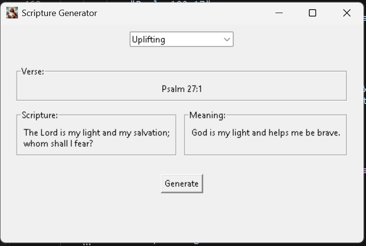
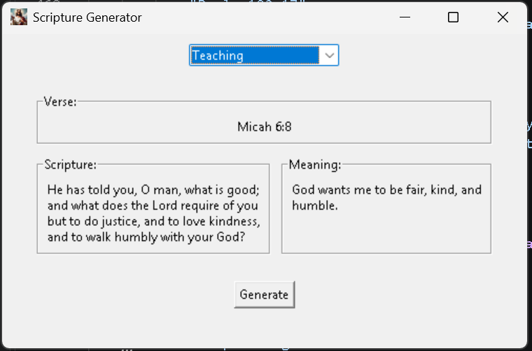
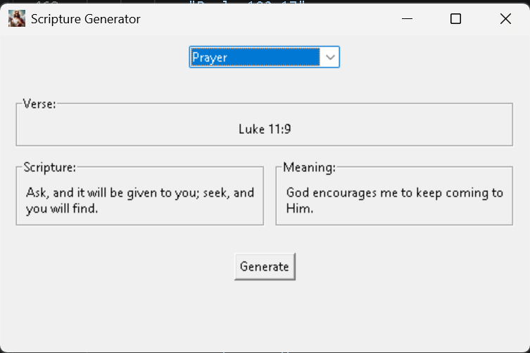

# Scripture Generator

## Description

Scripture Generator is a Python desktop application built using Tkinter that allows users to generate random Bible scriptures from different categories.

The application includes 90 scriptures divided into three categories: Uplifting, Teaching, and Prayer. Each scripture includes its Bible reference, verse text, and a simplified explanation to help younger readers understand its meaning.

The project demonstrates Python object-oriented programming, dictionaries, random selection, and graphical user interface development.

<details>
<summary><strong>Features</strong></summary>

## Features

- Generate random Bible scriptures.
- Choose between three scripture categories:
  - **Uplifting:** Encouraging verses about faith, hope, and strength.
  - **Teaching:** Scriptures focused on kindness, wisdom, and good behavior.
  - **Prayer:** Verses about prayer and communicating with God.
- Includes 90 scriptures, with 30 in each category.
- Displays the Bible reference, scripture text, and a child-friendly explanation.
- Uses a graphical user interface built with Tkinter.
- Automatically adjusts text wrapping for longer scriptures.
- Includes a custom application icon.

</details>

<details>
<summary><strong>Technologies Used</strong></summary>

## Technologies Used

- **Python:** Main programming language.
- **Tkinter:** Graphical user interface.
- **Pillow (PIL):** Image loading and application icon.
- **Random:** Random scripture selection.

</details>

<details>
<summary><strong>Requirements</strong></summary>

## Requirements

- Python 3.10 or newer (recommended).
- Pillow library.
- Tkinter (typically included with Python).

</details>

<details>
<summary><strong>Installation</strong></summary>

## Installation

### 1. Clone the Repository

```bash
git clone https://github.com/wschabel/ScriptureGenerator.git
```

Navigate to the project directory:

```bash
cd ScriptureGenerator
```

### 2. Install Dependencies

Install Pillow using pip:

```bash
python -m pip install Pillow
```

### 3. Run the Application

```bash
python scripture_generator.py
```

Make sure `scripgenimage.png` is located in the same directory as the Python script.

</details>

<details>
<summary><strong>How to Use</strong></summary>

## How to Use

1. Launch the Scripture Generator application.
2. Select a category from the dropdown menu.
3. Click the **Generate** button.
4. Read the randomly selected scripture and its explanation.
5. Click **Generate** again to display another scripture.
6. Change categories at any time to explore different types of scriptures.

</details>

<details>
<summary><strong>Project Structure</strong></summary>

## Project Structure

```text
ScriptureGenerator/
│
├── scripture_generator.py
├── scripgenimage.png
└── README.md
```

</details>

<details>
<summary><strong>Screenshots</strong></summary>

## Screenshots

### Uplifting Scriptures



### Teaching Scriptures



### Prayer Scriptures



</details>

<details>
<summary><strong>How It Works</strong></summary>

## How It Works

The application uses a `Scripture` class to store three pieces of information:

- **Location:** The Bible book, chapter, and verse.
- **Says:** The scripture text.
- **Meaning:** A simplified explanation of the scripture.

Scriptures are organized into nested dictionaries based on their categories.

When the user clicks **Generate**, the application identifies the selected category, randomly chooses a scripture from its dictionary, and updates the interface with the corresponding information.

New scriptures can be added to the existing dictionaries without modifying the scripture generation logic.

</details>

<details>
<summary><strong>Future Improvements</strong></summary>

## Future Improvements

Potential improvements include:

- Adding additional scripture categories.
- Expanding the scripture collection.
- Allowing users to save favorite scriptures.
- Adding a search feature to find specific Bible verses.
- Providing an option to copy scriptures to the clipboard.
- Supporting multiple Bible translations.

</details>

<details>
<summary><strong>Purpose</strong></summary>

## Purpose

This project was created to practice Python programming and GUI development while providing a simple way to explore Bible scriptures and their meanings.

It demonstrates working with classes, dictionaries, functions, event-driven programming, and third-party Python libraries.

</details>